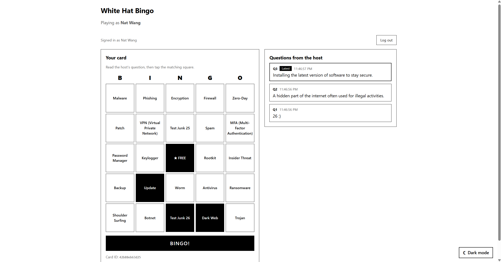
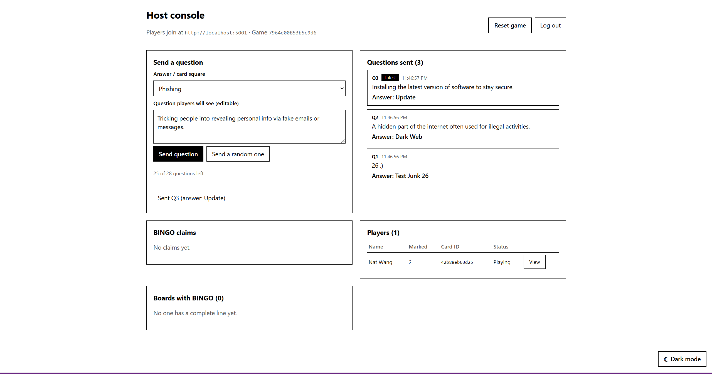
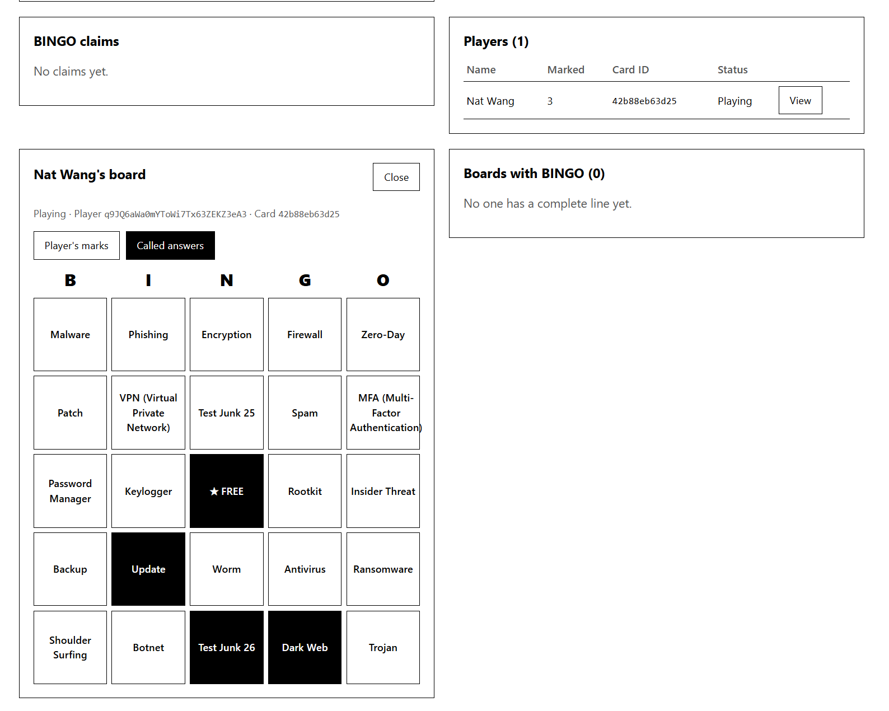
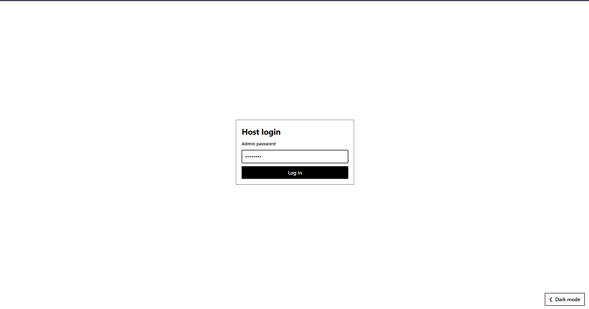

# White Hat Bingo

A web app for running cheat-proof cybersecurity bingo at CWRU events.

The host sends out definitions ("A tool that secretly records what you type."). Players work out the term and mark it on their card. Players sign in with a `@case.edu` account. Each card is generated from the game ID and the player's ID, and the server checks every BINGO claim against the questions that were actually called.

## Screenshots

**Player card.** Read the host's question, then tap the matching square.



**Host console** at `/admin`. Send questions, follow players' progress and check BINGO claims.



**Board viewer.** Check any player's card against their marks or against the answers that were called.



**Host login**



## Running it

The backend uses Python 3.13+ with [uv](https://docs.astral.sh/uv/). The frontend uses Node.

```bash
cp backend/.env.example backend/.env   # then set BINGO_ADMIN_PASSWORD
```

**Development:** run each of these in its own terminal.

```bash
cd backend && uv sync && uv run python app.py
```

```bash
cd frontend && npm install && npm run dev
```

Open http://localhost:5173 to play and http://localhost:5173/admin to host. Vite forwards `/api` requests to Flask on port 5001.

**Production:** build the frontend, and Flask serves it on port 5001.

```bash
cd frontend && npm install && npm run build
```

```bash
cd backend && uv run gunicorn -w 1 --threads 8 -b 0.0.0.0:5001 app:app
```

Keep `-w 1`. All game state lives in memory, so each extra worker would run a separate game.

## Configuration

Set these in `backend/.env` or as environment variables.

| Variable | Default | Purpose |
|---|---|---|
| `BINGO_ADMIN_PASSWORD` | `changeme` | Host console password. Change it. |
| `BINGO_MAX_PLAYERS` | `300` | Maximum number of players |
| `FIREBASE_PROJECT_ID` | `bingo-7280b` | Firebase project used for player sign-in |
| `PORT` | `5001` | Backend port |

## Questions

Terms and questions live in [`backend/questions.py`](backend/questions.py). A card needs at least 24 terms. Every card depends on this list, so don't edit it while a game is running. See [`backend/README.md`](backend/README.md) to rebuild a player's card for verification.
